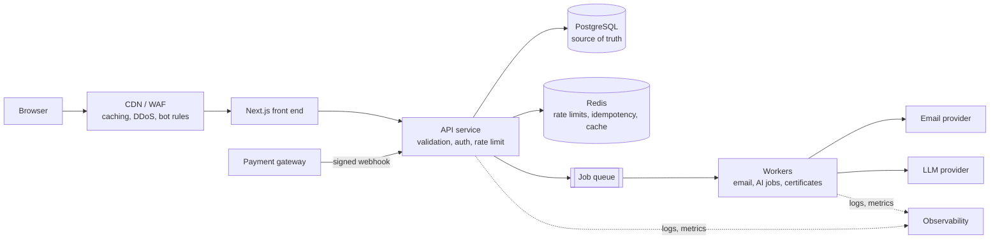

# Backend Technical Audit - Cynbit Technologies

**Prepared for:** Cynbit Technologies - Backend Developer Intern assessment
**Prepared by:** Kinchit Gupta
**Date:** 31 October 2026
**Scope:** Publicly visible website content at cynbit.in (see [`website-observations.md`](website-observations.md) for the evidence log)

### Where each required deliverable lives

| Required deliverable | Document |
|---|---|
| 1. Backend Technical Audit Report (architecture, observable behaviour, API structure and payloads) | **This document**, plus [`website-observations.md`](website-observations.md) and [`api-observation-worksheet.md`](api-observation-worksheet.md) |
| 2. Security & Performance Findings (categorized) | [`security-performance-findings.md`](security-performance-findings.md) |
| 3. Recommended Improvements (code snippets) | [`recommended-improvements.md`](recommended-improvements.md), working code in `app/` |

---

## 1. Read this first: scope and honesty

This is an **outside-in review** by a candidate. I had no access to Cynbit's source code,
servers, databases or traffic logs, and I did not probe, scan, or load-test anything.

Therefore:

- Findings labelled **Observed** come from public page content.
- Findings labelled **Consideration** are *good engineering practices that apply to a site
  with these features*. They are **not claims that Cynbit has these problems**. Many may
  already be handled in ways I cannot see.
- Anything I could not confirm is marked **To verify** rather than guessed.

The companion project in this repository (`app/`) turns each consideration into working,
tested code so the ideas are demonstrated, not just described.

## 2. What the website does

Cynbit Technologies is a Jaipur-based IT company. The site serves three audiences:

1. **Business clients** - AI automation, custom software, cloud and marketing services, plus
   three own products: *Cynbit Studio* (AI-assisted learning and career prep), *TenantEase*
   (property/tenant management) and *Revio* (AI review management).
2. **Students** - *BitElevate*, a 60-day remote internship programme with six tracks, paid
   enrolment, a private intern portal, daily pull-request reviews and QR-verifiable certificates.
3. **Job seekers** - a careers section with 20 openings, including this internship.

Marketing pages are the public face; behind them sit forms, a payment step, email delivery,
a database, and authenticated portals. That is where backend quality matters most.

## 3. Visible features and the backend work behind each

| Visible feature | Backend responsibilities it implies |
|---|---|
| Contact / demo-request forms (F1, F2) | Input validation, spam protection, storage, notification email, response-time tracking |
| BitElevate registration + payment (F3) | Duplicate prevention, payment-order creation, **payment-confirmation webhook**, account provisioning, credential delivery |
| Newsletter sign-up (F4) | Email validation, consent record, unsubscribe, list sync |
| Careers pages (F5) | Applications storage, file handling (if CV upload exists) |
| Intern portal | Authentication, sessions, task unlock logic, PR-link submission, review workflow, leave-freeze state |
| Certificates with public QR check | A public verification endpoint that must not leak data or be enumerable |
| Revio roles (Admin / Manager / Advisor) | Role-based access control, per-tenant data isolation |
| Studio "AI code evaluation", mock interviews | Safe execution of untrusted code (if run server-side), LLM calls with cost and abuse controls |

## 4. Observable technical signals

| Signal | Status |
|---|---|
| Front end appears to be **Next.js** (image optimiser URLs and a Next-specific meta tag) | Inferred, strong |
| **Prisma** (database layer) and **Resend** (email) are named in the privacy policy | Observed |
| **Cashfree** handles payments for BitElevate | Observed |
| The services page *offers* FastAPI, Django, NestJS, PostgreSQL, Redis, etc. | Observed - describes offerings, not necessarily this site's internals |

### Observable API behaviour

From page content alone I **cannot** state which API routes the forms call, what the JSON
looks like, or whether rate limiting, CSRF protection or bot checks exist. Those require
looking at network traffic, headers and responses. The passive method (reading response
headers and the site's own public JavaScript, never submitting forms) is written up step by
step in [`api-observation-worksheet.md`](api-observation-worksheet.md), and its results table
should be completed before submission. I deliberately did not send test submissions to a
production system, because the brief permits only passive and authorized testing.

> **Results of the passive browser checks:** *(add a short summary here after completing the
> worksheet: which headers were present, what endpoint/payload shape the client code revealed,
> Lighthouse scores. If a check was not possible, say so.)*

What *is* reasonable to say: a Next.js site that stores data through Prisma and sends mail
through Resend normally handles form posts in server-side route handlers or server actions,
validates them, writes to a database, and calls the email provider. The considerations below
follow from that general shape.

## 5. Risk and improvement register

Priority = how much it matters **if** the practice is absent (High / Medium / Low).
Each row names the demo code that illustrates the fix.

| # | Area | Consideration | Priority | Demonstrated in this repo |
|---|---|---|---|---|
| 1 | Public forms | Spam and abuse: bots can post thousands of submissions, exhausting email quota and polluting the lead list. Use per-client rate limits plus a bot check (CAPTCHA/honeypot) | High | `app/rate_limit.py`, `tests/test_rate_limit.py` |
| 2 | Input validation | Validate every field server-side (types, lengths, formats, allowed values); browsers can be bypassed. Reject unknown fields | High | `app/schemas.py` |
| 3 | Duplicate submissions | Double-clicks and network retries create duplicate leads or duplicate enrolments. Use idempotency keys plus database uniqueness | High | `app/idempotency.py`, `UNIQUE(email, domain_lab)` |
| 4 | Payments | Treat the *payment gateway's server-to-server webhook* as the source of truth, not the browser redirect. Verify the webhook signature, process each event once, and reconcile against the gateway | High | Pattern shown in section 8.4 |
| 5 | Credential delivery | The page says credentials are emailed after payment. Prefer a one-time "set your password" link over emailing a password; expire it quickly | High | Not implemented (out of scope) |
| 6 | Personal data | Names, phones, colleges and (for TenantEase) ID details are personal data. Minimise collection, restrict who can read it, encrypt at rest, define retention, and make deletion a real workflow | High | Admin-key gate on reads, `DELETE` endpoint |
| 7 | Privacy-policy alignment | The policy names two processors; the site also uses a payment gateway and a newsletter list. Keep the policy aligned with real data flows (India's DPDP Act, 2023) and review with qualified counsel | Medium | Documentation only |
| 8 | Authorisation | Roles (Admin/Manager/Advisor) and per-tenant data need *server-side, per-object* checks to prevent users reading each other's records (IDOR). Never rely on hiding buttons | High | `require_admin` pattern |
| 9 | Public certificate check | A QR-verification endpoint should use unguessable identifiers (not sequential numbers), return minimal data, and be rate limited | Medium | Same limiter pattern |
| 10 | Untrusted code execution | If Studio runs learners' code, it needs sandboxing (isolated containers, no network, CPU/memory/time limits) | High *(if applicable)* | Not implemented |
| 11 | AI features | Per-user quotas and spend caps, timeouts and retries with back-off, prompt-injection awareness, avoid sending unnecessary personal data to third-party models, human approval before auto-posting review replies | Medium | Rate-limit pattern applies |
| 12 | Email delivery | Do not block a user's request while calling the email API. Queue the send, retry on failure, and keep SPF/DKIM/DMARC configured | Medium | Architecture, section 6 |
| 13 | Error handling | Return one consistent error format and never leak stack traces or SQL | Medium | `app/errors.py`, `tests/test_health_and_errors.py` |
| 14 | Performance | Marketing pages are mostly static: serve via CDN/static generation and long-lived asset caching. Request images at realistic widths (student photos appear to be requested at `w=3840`). Index frequently queried columns; cache hot reads in Redis | Medium | Index on `inquiries(email)` |
| 15 | Observability | The services page claims 99.9% uptime. Backing that needs health checks, structured logs with request IDs, error tracking and alerts | Medium | `GET /health` |
| 16 | Metadata hygiene | Several pages declare the homepage as their `og:url`, and www/apex hosts are mixed. Use one canonical host with 301 redirects and a per-page canonical URL (relevant because technical SEO is a listed service) | Low | n/a |

## 6. Recommended backend architecture



Why each piece exists:

- **CDN/WAF** absorbs traffic spikes and obvious bot traffic before it reaches the app.
- **API layer** is the single place for validation, authentication, authorisation and rate limiting.
- **PostgreSQL** holds durable data; constraints (unique, foreign keys) enforce business rules.
- **Redis** gives fast shared counters, so rate limits and idempotency work across many servers.
- **Queue and workers** keep slow or flaky jobs (email, AI calls) out of the request path.
- **Webhook endpoint** receives payment results securely and idempotently.
- **Observability** makes the uptime claim measurable.

## 7. What the demo project implements

| What we identified | What the code demonstrates | Where | Verified by |
|---|---|---|---|
| Forms need validation | Pydantic models: lengths, formats, enums, phone/email normalisation, unknown fields rejected | `app/schemas.py` | `tests/test_inquiries.py`, `tests/test_enrollments.py` |
| Duplicate submissions possible | `Idempotency-Key` header, request fingerprint, atomic save, race handling; DB uniqueness for enrolments | `app/idempotency.py` | `tests/test_idempotency.py` |
| APIs need protection | Sliding-window rate limiter returning `429` + `Retry-After`; admin key for personal-data reads | `app/rate_limit.py`, `app/routes.py` | `tests/test_rate_limit.py` |
| Errors must be handled safely | One JSON error shape; generic `500` that hides internals | `app/errors.py` | `tests/test_health_and_errors.py` |
| Data needs persistence | SQLite with parameterised queries and constraints | `app/database.py` | all endpoint tests |
| Code needs verification | pytest suite with coverage reporting | `tests/` | `pytest --cov=app` |

## 8. Code examples

Snippets 8.1 and 8.2 are condensed from the repository code, which is covered by tests.
Snippets 8.3 and 8.4 are illustrative patterns and are **not** part of the repository.

### 8.1 Validation (`app/schemas.py`)

```python
class InquiryCreate(BaseModel):
    model_config = ConfigDict(extra="forbid", str_strip_whitespace=True)

    full_name: str = Field(min_length=2, max_length=100)
    email: EmailStr
    company: str | None = Field(default=None, max_length=120)
    message: str = Field(min_length=10, max_length=2000)
```

Bad input never reaches business logic; the client receives a `422` listing each bad field.

### 8.2 Duplicate-request prevention (`app/idempotency.py`)

```python
saved = _lookup(conn, key, endpoint, fp)      # seen this key before?
if saved is not None:
    response.headers["Idempotent-Replay"] = "true"
    return saved                              # replay, do NOT create again

with conn:                                    # one transaction:
    body = create(conn)                       #   1) create the record
    conn.execute("INSERT INTO idempotency_keys ...")   # 2) remember the answer
```

The record and the saved response commit together or not at all. If two identical requests
race, the table's primary key lets only one win and the other replays its response.

### 8.3 Shared rate limiting with Redis (illustrative, for production scale)

The demo keeps counters in memory, which breaks with several servers. A shared fixed-window
version would look like this:

```python
def allow(redis, client_id: str, limit: int = 5, window: int = 60) -> bool:
    key = f"rl:{client_id}:{int(time.time() // window)}"
    count = redis.incr(key)          # atomic across all servers
    if count == 1:
        redis.expire(key, window)    # counter cleans itself up
    return count <= limit
```

### 8.4 Verifying a payment webhook (illustrative pattern)

Follow the gateway's own documentation for the exact signing scheme; the general shape is:

```python
def handle_webhook(raw_body: bytes, signature: str, event_id: str):
    expected = hmac.new(SECRET, raw_body, hashlib.sha256).hexdigest()
    if not hmac.compare_digest(expected, signature):
        raise AppError(401, "bad_signature", "Invalid webhook signature.")
    # Process each gateway event exactly once (same idea as idempotency keys):
    if already_processed(event_id):
        return {"status": "duplicate_ignored"}
    mark_enrollment_paid(...)        # only now flip status to 'paid'
    queue_welcome_email(...)         # slow work goes to the queue
```

## 9. Testing evidence

- **64 automated tests, all passing; 100% line coverage** of `app/` (run with `pytest --cov=app`).
- Covers valid and invalid input, boundary lengths, injection-style text, admin access,
  pagination, duplicates, idempotent replay, the idempotency race, rate-limit window expiry,
  consistent errors, a simulated database outage, and a deliberately crashing route proving
  internals are not leaked.
- Also exercised against a live `uvicorn` server with `curl`.

Coverage shows code was *executed*, not that every scenario was imagined; the limits below remain.

## 10. Limitations and next steps

**Limitations of this report**

- Based on public page text only; no header, network or performance measurements.
- The demo is deliberately small: SQLite, in-memory rate limiter, shared-secret admin key, no
  payments, no email, no real authentication.

**Passive checks worth doing next** (listed with a results table in `website-observations.md`)

1. Response headers: HSTS, CSP, `X-Content-Type-Options`, `Referrer-Policy`.
2. HTTP -> HTTPS and www/apex redirects.
3. Caching headers on static assets, plus delivered image sizes.
4. A Lighthouse run for performance and accessibility.

**If extended with more time:** PostgreSQL with migrations (Alembic), JWT authentication with
roles, a Redis-backed limiter, a background worker for email, and a CI workflow that runs the
tests on every push.

## Sources

Public pages read on 31 Oct 2026: [contact](https://www.cynbit.in/contact),
[services](https://www.cynbit.in/services), [products](https://www.cynbit.in/products),
[BitElevate](https://www.cynbit.in/bitelevate), [careers](https://www.cynbit.in/careers),
[privacy](https://www.cynbit.in/privacy),
[GitHub organisation](https://github.com/Cynbit-Technologies/.github).
